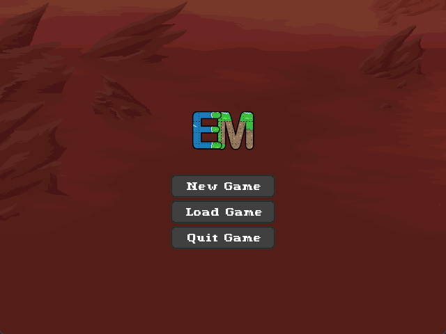
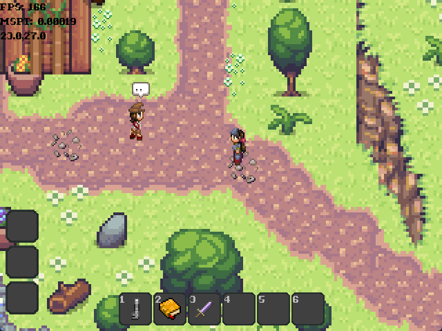
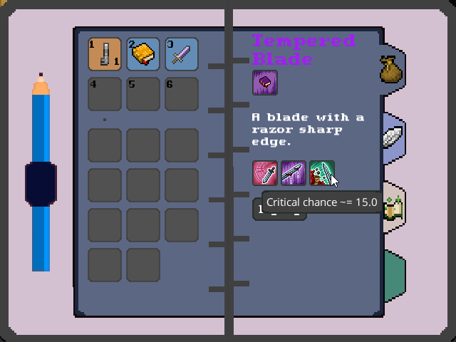
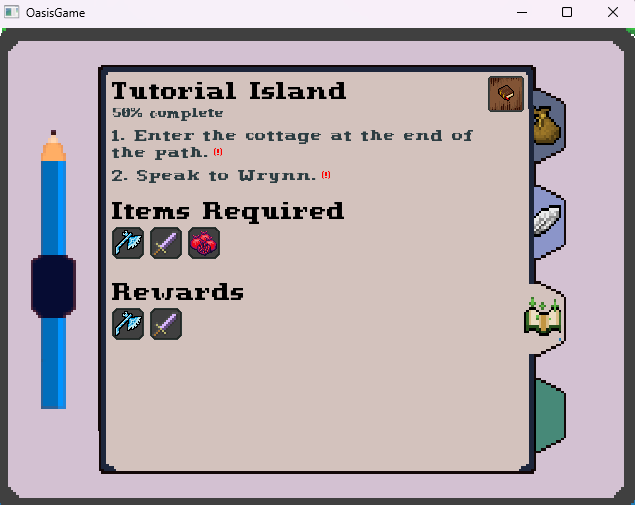
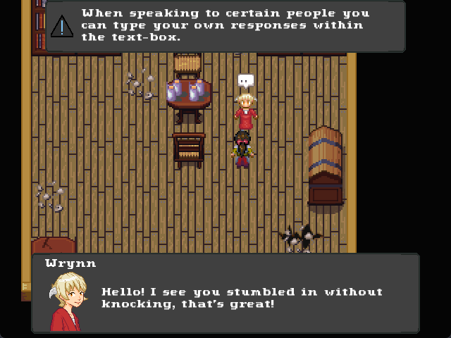
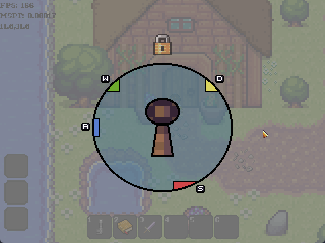
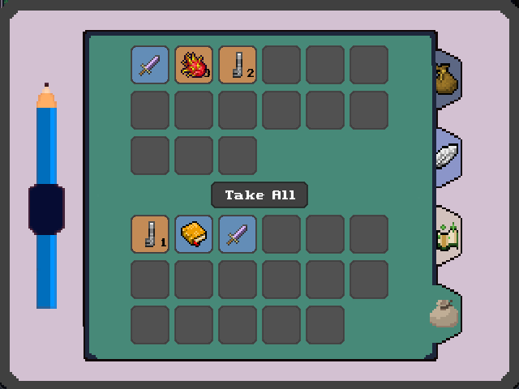

# Oasis
Oasis is a multiplayer game built with [Lunar](https://github.com/Vrekt/LunarGdx) and LibGDX.

Originally made by [Vrekt](https://github.com/Vrekt) — source: [Vrekt/OasisGame](https://github.com/Vrekt/OasisGame).

## Download (Windows)
Grab **Oasis-windows.zip** from the [latest release](../../releases/latest), unzip it, and run `Oasis\Oasis.exe`. Java is bundled, so nothing else needs installing.

## Building
- Run from source: `gradlew lwjgl3:run`
- Build the Windows app: `gradlew lwjgl3:jpackageImage` (output in `lwjgl3/build/jpackage/Oasis`)
- Every push to `main` builds the exe on GitHub and publishes it as a new release automatically.

# Features as of 6/13/24
- Multiple worlds
- Multiple enterable interiors
- Guis:
  - HUD
  - Chat
  - Inventory
  - Containers
  - Quest
  - WorldMap
  - Dialog
  - Lockpicking
  - Misc, like signs
- Saving and loading
- Entities with AI and states
- Basic combat with animations
- Activities like lockpicking
- Area effect clouds, like minecraft
- Many different types of interactions
- Items, weapons, artifacts
- Item attributes and player effects
- Basic sound
- Basic multiplayer

  

  

  

  

  

  

  

